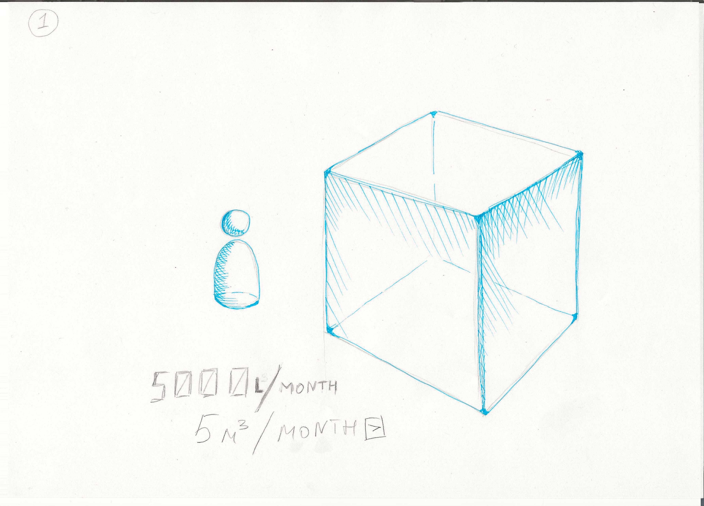

# 01 – scrollable story inidividual water usage

- **Description:** The website begins with a scrollable narrative story that puts all the information used into relatable context. We plan to use the annual mass-balance data of Aletsch Glacier, more specifically the net loss of stored water in the glacier in comparison to the volume of water households consume annually to contextualize the sheer volume of water that melts each year. On the first screen, triggered by the first scroll: Singular person’s water usage per month. 7,860 L (7.86 m³). Next to the person icon, this amount of water is visualized as one 3 dimensional water-cube worth approximately 7,860 L (7.86 m³). Singular person’s water usage per year is around 95,630 L (95.63 m³). On the left top corner, the number of the page is shown to indicate a linear narration (so this is 1)
- **Trigger:** Vertical scrolling reveals this page. Another scrolls progresses the narrative. Horizontal scrolls reveals singular person’s water usage per year is around 95,630 L (95.63 m³) instead of per month 7,860 L (7.86 m³)
- **Response:** the person icon shrinks in size and 39 more person icons show up in columns of 5 and rows of 8 to visualize 40 people living in an apartment in a smooth animation. The singular water cubes shrinks and stacks on top of 40 water cubes in a form of a mountain or irregular pyramid → see `02_scrollable_story_apartment_water_usage`
- **Data:** Retrieve the water consumption data from data/KANTON_ZUERICH_469.csv → columns BFS_NR, INDIKATOR_JAHR, and INDIKATOR_VALUE. Filter the dataset to BFS_NR = 261 (City of Zürich) and INDIKATOR_JAHR = 2023, where INDIKATOR_VALUE = 262, representing the average daily water consumption of 262 litres per resident. Use this value to calculate the water consumption of a single resident per day, month, and year. Daily consumption is 262 litres (0.262 m³), monthly consumption is calculated using 262 × 30 = 7,860 litres (7.86 m³), and yearly consumption using 262 × 365 = 95,630 litres (95.63 m³). Convert all values from litres into cubic metres by dividing by 1000. The calculated volume determines the size of the three-dimensional water cube, which grows or shrinks proportionally when switching between daily, monthly, and yearly consumption through horizontal scrolling. Monthly consumption is estimated using a 30-day month rather than actual monthly measurements.
- **States:** daily use / monthly use / yearly use (shown upon horizontal scroll)
- **Remarks:** 
