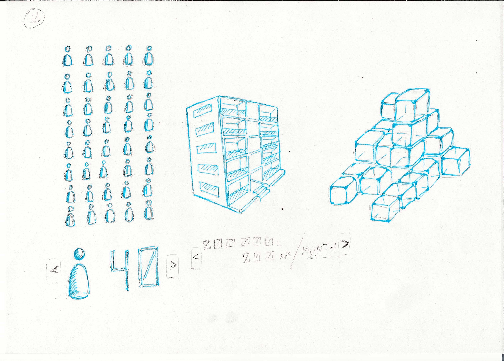

# 02 - scrollable story apartment water usage

- **Description:** 40 person icons show up in columns of 5 and rows of 8 to visualize 40 people living in an apartment in a smooth animation on the left side. The singular water cubes shrinks and stacks on top of 40 water cubes in a form of a mountain or irregular pyramid on the right side. in the middle, a 3d model of a an apartment. on the bottom, the number of water liters used of all of these residents is show. so for 40 residents, it would be approximately 200,000 L of water or 200m3 per month. 
- **Trigger and Response:** this page is more interactive as upon horizontal scrolls, the number of residents of the apartment increases in intervals of 10 (so 40,50,60,70,80) and the apartment also increases in floors to accomodate this number of people. when this happens, more water cubes fall down or materialize on the 3d pyramid / mountain of water cubes. when hovered on the amount of water used, and then horizontally scrolled, it also changes to yearly usage (calculate that using the INDIKATOR_VALUE average) and the mountain of watercubes increases accordingly. it can shrink to give more place to more water cubes.
- **Response:** when scrolled vertically, the next page appears (03_scrollable_story_city_water_usage), the appartment and humam icons disappear and instead, a map of zurich shows up on the left side appears and the mountain of water cubes starts increasing as well since the next scroll narration shows the water usage of the entire city→ see `03_scrollable_story_city_water_usage`
- **Data:** Retrieve the water consumption data from data/KANTON_ZUERICH_469.csv → columns BFS_NR, INDIKATOR_JAHR, and INDIKATOR_VALUE. Filter the dataset to BFS_NR = 261 (City of Zürich) and INDIKATOR_JAHR = 2023, where INDIKATOR_VALUE = 262, representing the average daily water consumption of 262 litres per resident. Use this value to calculate the total monthly and yearly water consumption for apartments containing 40, 50, 60, 70, or 80 residents. Calculate monthly consumption using number_of_residents × 262 × 30 and yearly consumption using number_of_residents × 262 × 365. Convert the resulting litres into cubic metres by dividing by 1000. For example, 40 residents consume approximately 314,400 litres (314.4 m³) per month or 3,825,200 litres (3,825.2 m³) per year. The calculated volume determines the number and size of the water cubes forming the water-cube mountain, which grows or shrinks proportionally when changing the number of residents or switching between monthly and yearly water consumption. The resident icons and apartment floors also update to correspond to the selected number of residents. Monthly consumption is estimated using a 30-day month rather than actual monthly measurements.
- **States:** monthly usage of 40 residents / monthly usage of 50 residents / monthly usage of 60 residents / monthly usage of 70 residents / monthly usage of 80 residents / yearly usage of 40 residents / yearly usage of 50 residents /yearly usage of 60 residents / yearly usage of 70 residents / yearly usage of 80 residents
- **Remarks:** add buttons ("<" and ">") on the side of each changeable variables to show people that they can change the number of residents and whether it shows monthly or yearly usage of water.
