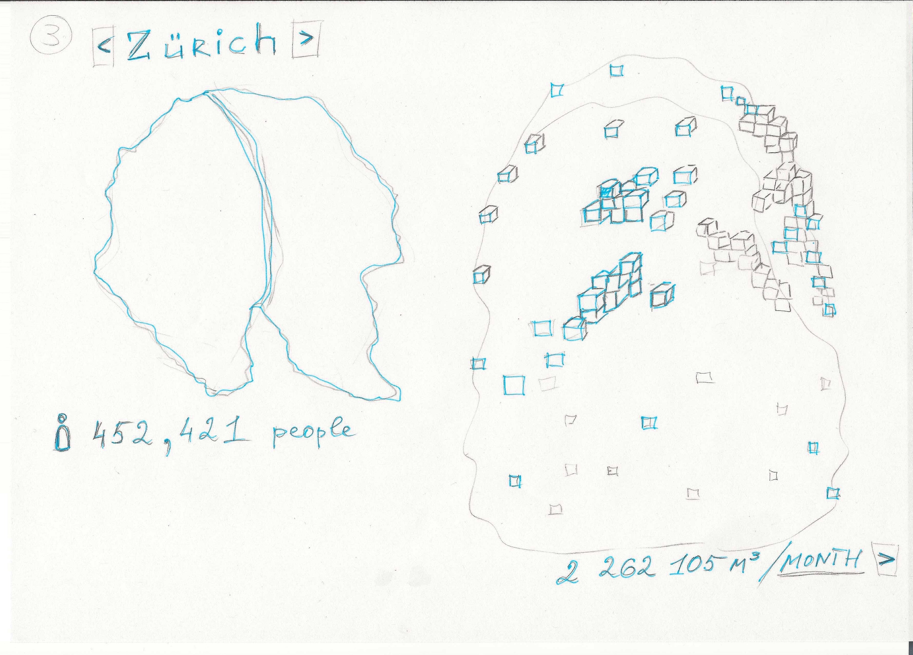

# 03 – scrollable story city water usage

- **Description:** on the left side, a map of zurich appears, signifying that this scroll is about the water usage of all the inhabitants of the city, which is approximately 452,421 inhabitants that is written under the map. on the right side, the mountain of cubes is now very large to showcase the great amount of water used by all of these residents. on the bottom, it shows at first that it accumulates to 2 262 105 m3 of water usage per month. 
- **Trigger and Response:** this page is also interactive upon horizontal scroll (when hovered on the map), the city changes from Zurich and 4 other cities and their residents can be selected (works as a carousel): London, New York, Paris and Tokyo. This also changes the number of residents shown at the bottom to correspond to the city (pull this value from the file data/residents_cities_water_usage.csv → column residents). The size of the water cube mountain and the calculated value of water usage per city also corresponds to the change in city. you can calculate these values using the values in data/residents_cities_water_usage.csv → column water_usage_per_day. when hovered on the number of residents and then horizontally scrolled, or on the water cube mountain and then horizontally scrolled, the calculated value of water usage per year will show. It will also work as in a carousel, so the user can go between usage per month and per year. and then the water cube mountain will correspond to that changing number as well with an animation of stacking.
- **Response:** when scrolled vertically, the next page appears (04_scrollable_story_comparison_to_aletsch) on the x-axis to the left. so the map of the city goes out of the frame to the left, and the water cube mountain moves to its place. from the right (so now in the place of the water-cube mountain), the water-cube mountain of the net mass of all the melted ice/melted water shows up (226,200,000 m3). it is so large that it goes out of the frame (so allthe water-cubes don't have to be rendered)
- **Data:** Retrieve the city data from data/residents_cities_water_usage.csv → columns city, residents, and water_usage_per_day. The residents column determines the population number displayed beneath the map for each of the five cities (Zurich, New York, London, Paris, and Tokyo), while water_usage_per_day represents the daily water consumption per resident in litres. For Zürich, where water_usage_per_day is missing, retrieve the value from data/KANTON_ZUERICH_469(1).csv → column INDIKATOR_VALUE, filtered to BFS_NR = 261 and INDIKATOR_JAHR = 2023, giving 262 litres per resident per day. Do not calculate the average of the entire column, as it contains values from different municipalities and years. Calculate the total monthly water consumption using residents × water_usage_per_day × 30 and the yearly consumption using residents × water_usage_per_day × 365. Convert both results from litres to cubic metres by dividing by 1000. For Zürich, with 452,421 residents, this results in approximately 3,556,029 m³ per month and 43,265,020 m³ per year. The calculated volume determines the size of the water-cube mountain, which grows or shrinks proportionally when changing cities or switching between monthly and yearly consumption. All displayed population numbers and water volumes should update dynamically according to the selected city and time period. Monthly consumption is estimated using a 30-day month, rather than actual monthly measurements.
- **States:** monthly water usage of zurich / yearly water usage of zurich / monthly water usage of new york / monthly water usage of london / monthly water usage of paris / monthly water usage of tokyo / yearly water usage of new york / yearly water usage of london / yearly water usage of paris / yearly water usage of tokyo / 
- **Remarks:** add buttons ("<" and ">") on the side of each changeable variables to show people that they can change the city and whether it shows monthly or yearly usage of water.

