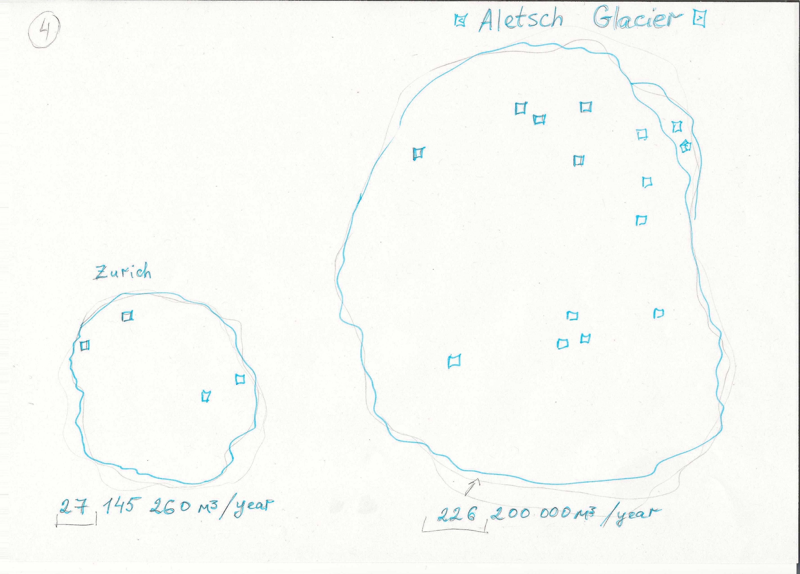

# 04 – scrollable story comparison to aletsch

- **Description:** Grosser Aletschgletscher had an annual mass balance of approximately −3.0 metres water equivalent. Reported surface area of approximately 75.4 km2, so 75 400 000 m3. This is 75 400 000 m2 * 3 = 226,200,000 m3 ("In 2025/26, Aletsch Glacier lost enough frozen water to cover its entire 75.4 km² surface with a layer of liquid water 3 metres deep.”) (Water-equivalent volume). the map of the city goes out of the frame to the left, and the water cube mountain moves to its place. from the right (so now in the place of the water-cube mountain), the ice-cube mountain of the net mass of all the melted ice/melted water from shows up (226,200,000 m3). it is so large that it goes out of the frame (so allthe water-cubes don't have to be rendered). the water-cube mountain of all the usage based on city can also shrink to fit into the scale of Grosser Aletschgletscher. Next to a mountain of water cubes from water usage of Zurich city (27 145 260 m3), which is around 8.4 times smaller. 

- **Trigger and response:** on top, above the title "Grosser Aletschgletscher", you see buttons which allow you to switch the 5 largest glaciers by area when horizontally scrolled and hovered over this side of the screen and based on the water-equivalent of them, calculate the amount of melted water and visualize in a form of a water-cube mountain next to the mountain of water usage of residents of zurich or whatever city one is choosing (it is still possible to change the city at this point in the same manner as the glacier, so horizontal scroll when hovered on this side of the screen). this is the last page of the scrollytelling narration and after that, the main front page is revealed (see `05_overall_front_page_aletsch_comparison`)

- **Data:** Retrieve the glacier data from `data/massbalance_fixdate_2025_r2025.csv` → columns `glacier name`, `end date of observation`, `annual mass balance`, and `glacier area`. Use the 2025 measurements of the five largest glaciers by area with available data: Grosser Aletschgletscher, Glacier de Corbassière, Rhonegletscher, Findelgletscher, and Glacier d'Otemma. The annual mass balance is measured in millimetres water equivalent (mm w.e.), while the glacier area is measured in km². Calculate the annual net water-equivalent loss in cubic metres using `abs(annual_mass_balance) × glacier_area × 1000`, only for negative mass balance values. The result determines the size of each glacier's water-cube mountain.

For the cities, retrieve the data from `data/residents_cities_water_usage.csv` → columns `city`, `residents`, and `water_usage_per_day`. Use the number of residents and daily water consumption per resident to calculate monthly water usage with `residents × water_usage_per_day × 30` and yearly water usage with `residents × water_usage_per_day × 365`. Convert the resulting values from litres to cubic metres by dividing by 1000. For Zürich, where `water_usage_per_day` is missing, retrieve the value from `data/KANTON_ZUERICH_469(1).csv` → column `INDIKATOR_VALUE`, filtered to `BFS_NR = 261` and `INDIKATOR_JAHR = 2023`, giving 262 litres per resident per day.

Compare the glacier's annual net water-equivalent loss with the selected city's monthly or yearly water consumption by dividing `glacier_water_loss_m3 / city_water_usage_m3`. Both water-cube mountains should use the same scale, and their sizes and comparison ratio should update dynamically when switching glaciers, cities, or time periods. The glacier CSV contains measurements through 2025, while the 2025/26 Aletsch example of approximately −3.0 m w.e. comes from `data/Annualbalance_Swissglaciers2026.pdf`. Use this report separately if displaying the 2026 example. The glacier figures represent net water-equivalent loss rather than directly measured meltwater runoff, and monthly city consumption is estimated using a 30-day month.

- **States:** There are 50 possible states in total (5 glaciers × 5 cities × 2 consumption periods). For each glacier, the following states are possible:

Grosser Aletschgletscher: monthly water usage of Zürich / yearly water usage of Zürich / monthly water usage of New York / yearly water usage of New York / monthly water usage of London / yearly water usage of London / monthly water usage of Paris / yearly water usage of Paris / monthly water usage of Tokyo / yearly water usage of Tokyo.

Glacier de Corbassière: monthly water usage of Zürich / yearly water usage of Zürich / monthly water usage of New York / yearly water usage of New York / monthly water usage of London / yearly water usage of London / monthly water usage of Paris / yearly water usage of Paris / monthly water usage of Tokyo / yearly water usage of Tokyo.

Rhonegletscher: monthly water usage of Zürich / yearly water usage of Zürich / monthly water usage of New York / yearly water usage of New York / monthly water usage of London / yearly water usage of London / monthly water usage of Paris / yearly water usage of Paris / monthly water usage of Tokyo / yearly water usage of Tokyo.

Findelgletscher: monthly water usage of Zürich / yearly water usage of Zürich / monthly water usage of New York / yearly water usage of New York / monthly water usage of London / yearly water usage of London / monthly water usage of Paris / yearly water usage of Paris / monthly water usage of Tokyo / yearly water usage of Tokyo.

Glacier d'Otemma: monthly water usage of Zürich / yearly water usage of Zürich / monthly water usage of New York / yearly water usage of New York / monthly water usage of London / yearly water usage of London / monthly water usage of Paris / yearly water usage of Paris / monthly water usage of Tokyo / yearly water usage of Tokyo.

Each state displays the corresponding glacier and city names, both water volumes in cubic metres, and the ratio between them. When switching between states, the water-cube mountains grow or shrink proportionally while maintaining a consistent scale.

- **Remarks:** add buttons ("<" and ">") on the side of each changeable variables to show people that they can change the city and whether it shows monthly or yearly usage of water.

