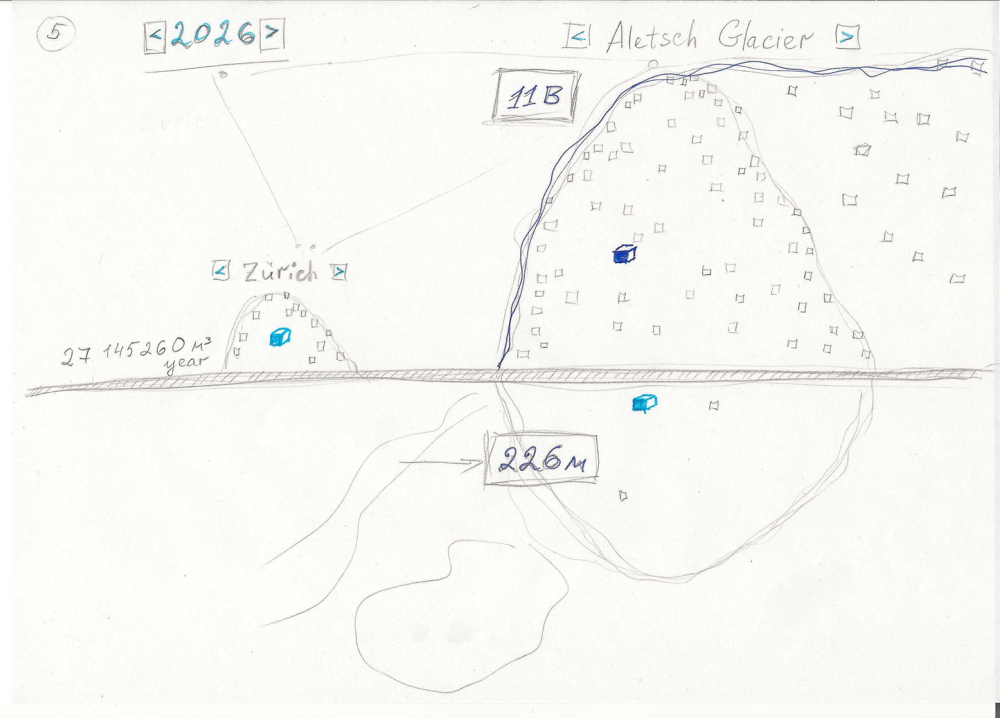

# 05 – overall front page aletsch comparison

- **Description:** This is the main front page of the website and visualization, accessible after completing the scrollytelling narrative. It shows a graph divided into two halves by a horizontal axis in the middle. The upper, positive half represents the amount of snow and ice mass gained by the selected glacier during winter, visualized as a mountain of frozen ice cubes. The lower, negative half represents the amount of mass lost during summer, visualized as an upside-down mountain of water cubes, resembling the bottom of an iceberg. Both quantities are expressed in cubic metres of water equivalent, allowing their volumes to be compared directly. The summer loss is generally much larger than the winter accumulation, visually communicating why the glacier experiences a negative annual mass balance. For example, in 2025, Grosser Aletschgletscher gained approximately 82.1 million m³ of water equivalent during winter but lost approximately 204.5 million m³ during summer, resulting in a net annual loss of approximately 122.4 million m³. The name of the selected glacier appears at the top of the screen, alongside the corresponding values for winter accumulation, summer loss, and net annual mass balance. The background of the negative half resembles the ground and water, with subtle animations suggesting melting and water outflow into rivers and lakes. The mountains can extend beyond the screen to emphasize their enormous volumes, while maintaining the same scale so that the difference between accumulation and loss remains visually accurate.
- **Trigger & Response:** Users can interact with the visualization by clicking buttons to switch between five glaciers (Grosser Aletschgletscher, Glacier de Corbassière, Rhonegletscher, Findelgletscher, and Glacier d'Otemma), five cities (Zürich, New York, London, Paris, and Tokyo), and monthly or yearly city water consumption, creating 50 possible combinations. Unlike the previous scrollytelling pages, these variables are changed through buttons rather than horizontal scrolling. When a different glacier is selected, the positive and negative cube mountains grow or shrink through stacking animations to represent the new winter accumulation and summer mass loss. The selected city and consumption period determine the additional water-usage comparison and its ratio to the glacier's net annual loss. At the top of the page, a historical timeline allows users to explore previous years of glacier measurements. Moving along the timeline changes the winter and summer mass balances, glacier surface area, and calculated water-equivalent volumes, allowing users to observe how the relationship between winter accumulation and summer loss has changed over time. The city water-consumption values remain unchanged when navigating the historical glacier timeline.
- **Data:** Retrieve the historical glacier data from data/massbalance_2025_r2025/massbalance_fixdate_2025_r2025.csv → columns glacier name, end date of observation, winter mass balance, summer mass balance, annual mass balance, and glacier area. Use the measurements of the five selected glaciers: Grosser Aletschgletscher, Glacier de Corbassière, Rhonegletscher, Findelgletscher, and Glacier d'Otemma. The mass balance values are measured in millimetres water equivalent (mm w.e.), while the glacier area is measured in km². Calculate the winter accumulation in cubic metres using winter_mass_balance × glacier_area × 1000 and the summer mass loss using abs(summer_mass_balance) × glacier_area × 1000, with the positive and negative values determining the sizes of the corresponding cube mountains. Calculate the annual net water-equivalent loss using abs(annual_mass_balance) × glacier_area × 1000, only for negative annual mass balances. The historical timeline uses end date of observation to retrieve the corresponding measurements for each available year. If a seasonal balance is negative during winter or positive during summer, represent it according to its actual sign rather than automatically treating winter as accumulation and summer as loss.

For the city comparison, retrieve the data from data/residents_cities_water_usage.csv → columns city, residents, and water_usage_per_day. Calculate monthly water consumption using residents × water_usage_per_day × 30 and yearly consumption using residents × water_usage_per_day × 365, then convert the results from litres to cubic metres by dividing by 1000. For Zürich, retrieve the missing daily water consumption value from data/KANTON_ZUERICH_469(1).csv → column INDIKATOR_VALUE, filtered to BFS_NR = 261 and INDIKATOR_JAHR = 2023, giving 262 litres per resident per day. Compare the selected glacier's annual net water-equivalent loss with the selected city's monthly or yearly water usage using glacier_water_loss_m3 / city_water_usage_m3. All glacier values update according to the selected year, while city water-consumption values remain fixed. The glacier CSV contains measurements through 2025, and data/Annualbalance_Swissglaciers2026.pdf provides additional 2025/26 measurements that can be incorporated separately.
- **States:** The visualization has different states depending on the selected glacier, city, water-consumption period, and historical year. Users can switch between five glaciers, five cities, and monthly or yearly city water consumption, resulting in 50 possible glacier-city-period combinations for each available historical year. Each combination displays the selected glacier's winter accumulation on the positive side, summer mass loss on the negative side, net annual water-equivalent loss, and the corresponding comparison with the selected city's water consumption. The historical timeline introduces additional states for each available measurement year, updating the glacier's seasonal mass balances, surface area, and cube-mountain sizes. The city water-consumption values do not change when the historical year is adjusted. The visualization also has an expanded viewing state in which the cube mountains extend beyond the visible frame, emphasizing the scale of the quantities while preserving their relative proportions. Switching between states triggers smooth animations in which cubes accumulate, disappear, or rearrange to represent the newly selected values.
- **Remarks:** Add buttons ("<" and ">") beside the changeable glacier and city names, as well as a clear monthly/yearly toggle, to indicate that users can switch between the available options. The historical timeline should show only years for which the selected glacier has available data. Both cube mountains must use the same volumetric scale to preserve an accurate comparison between winter accumulation and summer loss. The upper mountain represents winter snow accumulation expressed as water equivalent, not the glacier's total remaining ice volume, while the lower mountain represents summer mass loss rather than directly measured meltwater runoff. The difference between the two represents the annual net mass balance and should be highlighted visually. Add clear labels indicating the selected glacier, measurement year, water-equivalent volume, and data sources. The 2026 annual report should be treated separately from the 2025 CSV to avoid mixing measurements from different hydrological years.
